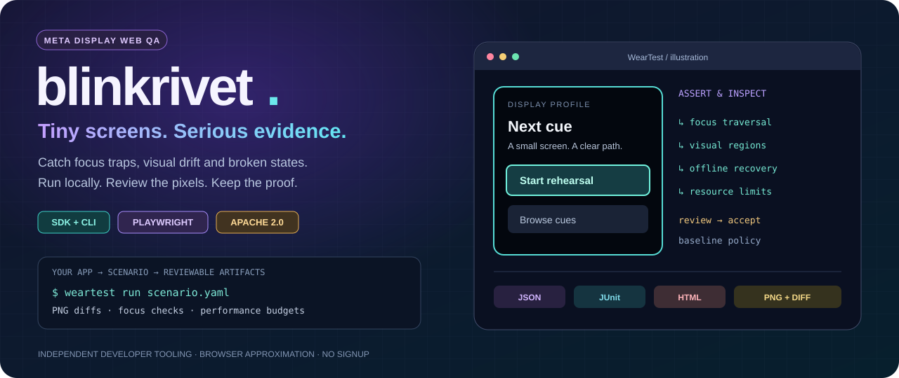
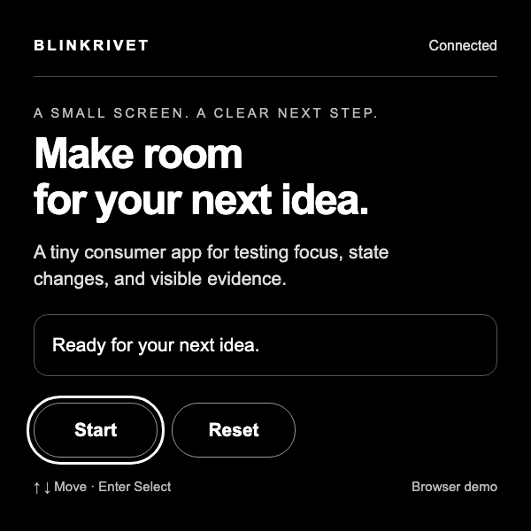
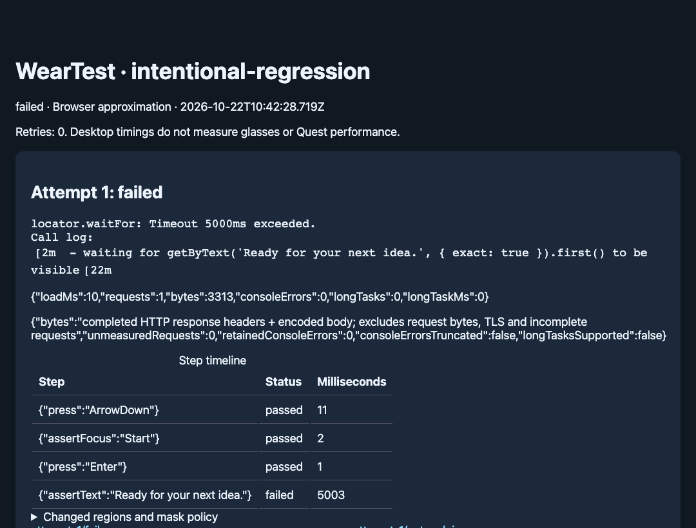
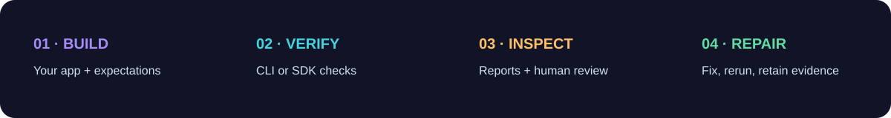

<p align="center">
  
</p>
<p align="center">
  <a href="https://www.npmjs.com/package/@adiitj/blinkrivet"></a>
  <a href="LICENSE"></a>
  
  <a href="https://github.com/ADIITJ/blinkrivet-docs/actions/workflows/docs.yml"></a>
</p>

<h3 align="center">Your AI built the app. Give it evidence to improve it.</h3>
<p align="center">A testing library and CLI for <strong>Meta Display web apps</strong>.<br>Production checks. Reviewed visuals. Repeatable measurements.</p>
<p align="center">
  <a href="#quickstart">Quickstart</a> · <a href="#see-the-evidence">See the evidence</a> · <a href="docs/AGENTS.md">Coding agents</a> · <a href="docs/REVIEW.md">Official Meta review</a> · <a href="docs/FAQ.md">FAQ</a>
</p>

A clipped cue, a lost focus ring, an offline screen that never recovers: on a small display, one broken interaction can derail the experience. **Blinkrivet turns declared app behaviour into browser checks and reviewable evidence.** Run it yourself, call it from JavaScript, or put it in your AI coding loop.

No account. No hosted test service. Install the npm package and use your own machine or CI.

> **This is the public documentation and examples repository.** The full development repository remains private. The public npm package includes its runtime sources and compiled JavaScript. This repo does not contain the library implementation, internal tests, release infrastructure, or development history.

## Quickstart

Requires **Node 22.14+**. In your own app:

```sh
npm install --save-dev @adiitj/blinkrivet
npx weartest setup
npx weartest doctor
npx weartest init
```

Start your app and edit `weartest.json` to match its URL, controls, and expected states. Then:

```sh
npx weartest run weartest.json --output .weartest/first-look
npx weartest report .weartest/first-look
```

A first screenshot exits **1** with `BASELINE_MISSING`: it needs review. Inspect the original images and assertions before accepting an eligible visual baseline:

```sh
npx weartest baseline accept .weartest/first-look --reviewed
npx weartest run weartest.json --output .weartest/verified
```

Use a **fresh output directory** for every run. CI cannot accept baselines; failing assertions or performance budgets cannot be approved away.

**Want a working example first?** [Run the public demo](docs/QUICKSTART.md#try-the-public-demo) using only this repository and the published npm package.

## See the evidence

<table>
<tr><th>A real demo checkpoint</th><th>A real failed assertion report</th></tr>
<tr>
<td></td>
<td></td>
</tr>
</table>

These images come from the public demo running in desktop Chromium. The second case intentionally leaves the app in its preparing state. It is a demonstrated failure, not a simulated passing result. The banner is an illustration; none of these images are physical-glasses captures.

A run retains a static HTML report, JSON, JUnit, screenshots and eligible visual diffs. An official review adds per-layer results and an agent handoff. [Understand the outputs →](docs/EVIDENCE.md)

## Capabilities

| What you need to check | What Blinkrivet provides |
| --- | --- |
| **App flows** | Named assertions, directional input, expected focus, loading/error states and connectivity changes |
| **Visual changes** | Human-reviewed PNG baselines, pixel diffs, bounded masks and rendering provenance |
| **Official app requirements** | Bundled, pinned, integrity-checked Meta validators for the supported app contract |
| **Production performance** | Repeated cold/warm launches; optional A/B comparisons and null controls |
| **Worker traffic** | Independent HTTP accounting in production profiling, with explicit supported boundaries |
| **AI-assisted repair** | Machine-readable failures and saved artifacts for the next coding iteration |

Browser results are estimates. Physical optics, real gestures, voice integration and on-glasses timings need separate device evidence. [Coverage and limits →](docs/CAPABILITIES.md)

## One command for an official review

```sh
npx weartest init-review
# Edit the generated feature scenario and usable-content oracle for your app.
npx weartest review --output .weartest/review-001
```

The review builds your supported app, runs the bundled Meta gate, checks your production features, and measures repeated launches. You supply the expected behaviour and the expression that identifies usable content. Missing required evidence produces **INCOMPLETE**; unobserved simulator/device layers remain **NOT_RUN**.

No separate Meta toolkit checkout is needed. [Configuration and prerequisites →](docs/REVIEW.md)

## For coding agents



```js
import { runScenario } from "@adiitj/blinkrivet";

const { result, reportPath } = await runScenario(scenario);
if (result.status !== "passed" || result.flaky) {
  throw new Error(`Inspect the evidence: ${reportPath}`);
}
```

An agent should fix the app, rerun checks, and bring visual changes to a human for review. It should never lower a budget or approve a baseline merely to obtain a pass. [Agent workflow →](docs/AGENTS.md) · [Runnable SDK example →](examples/run-agent.mjs)

## Verification you can inspect

The 0.2 runtime passed **41 tests on macOS, 41 on Linux, and 38 on Windows with 3 explicit platform skips**. All 13 macOS quality gates and both remote CI jobs passed. The 0.2.1 patch changes metadata/docs only; its runtime matches 0.2.0 byte for byte. Its packed install passed 21 checks and its independent registry install passed 7 checks.

Those are maintainer release results. The public badge above verifies **these docs and consumer examples**, not the private library test suite. [Verification scope →](docs/EVIDENCE.md)

## Explore

| Guide | Start here when… |
| --- | --- |
| [Quickstart](docs/QUICKSTART.md) | You want to run your first scenario or the public demo |
| [CLI & scenarios](docs/CLI.md) | You need commands, exit codes and baseline rules |
| [Official Meta review](docs/REVIEW.md) | You want the production review workflow |
| [Coding agents & SDK](docs/AGENTS.md) | You are integrating an AI coding loop or JavaScript |
| [Evidence](docs/EVIDENCE.md) | You need to interpret results and release claims |
| [Capabilities & limits](docs/CAPABILITIES.md) | You need to know what browser checks can establish |
| [FAQ](docs/FAQ.md) | You have setup, privacy or compatibility questions |

Documentation feedback and reproducible usage questions are welcome in [GitHub Discussions](https://github.com/ADIITJ/blinkrivet-docs/discussions). Do not post secrets, proprietary app source, or unreviewed screenshots. See [contributing](CONTRIBUTING.md) and [security](SECURITY.md).

**Apache-2.0** · [License](LICENSE) · [npm package](https://www.npmjs.com/package/@adiitj/blinkrivet) · [Changelog](CHANGELOG.md)

Independent tooling, unaffiliated with Meta. Meta and Ray-Ban names identify compatible products; they do not imply endorsement.
